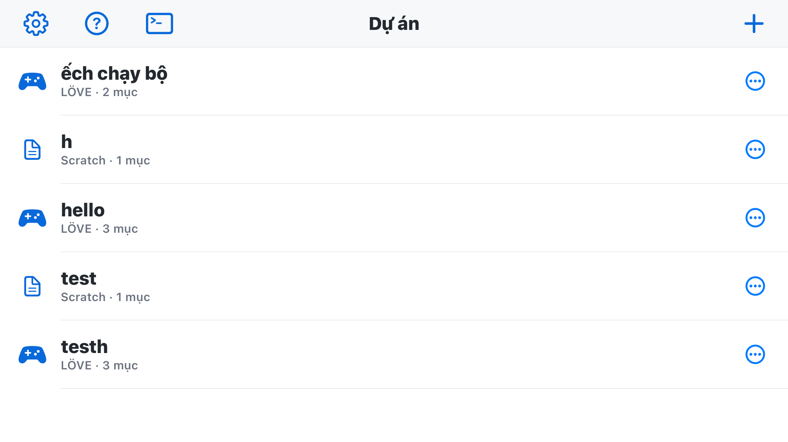
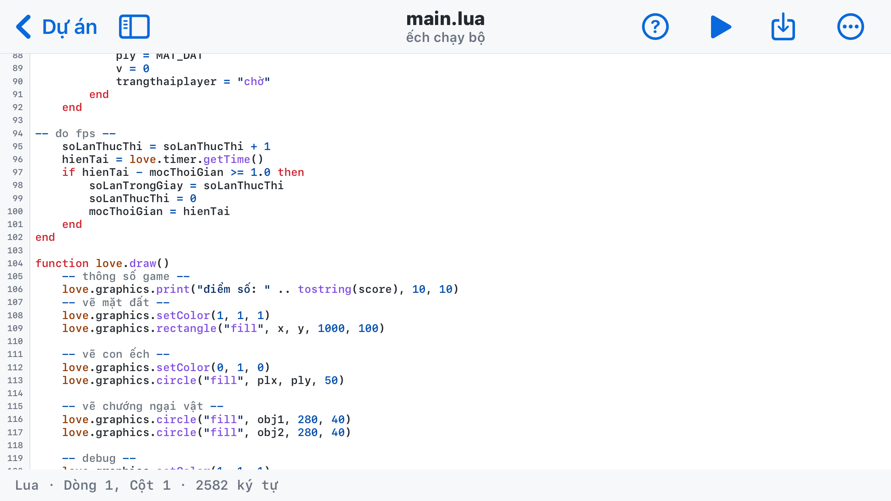
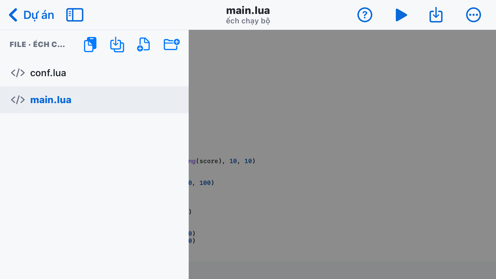
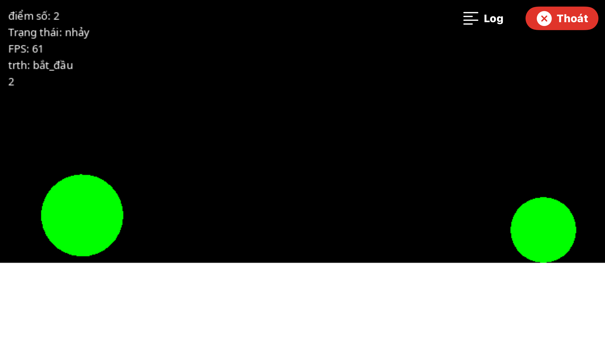

# Catnip Engine: game maker for IOS
## Catnip Engine
- Catnip Engine: game maker for IOS
## Introduction
- Welcome to Catnip Engine! This is a game engine powered by a Love2D core. Designed specifically for IPhone.
- This tool lets developers program directly on a mobile device (IPhone).
- Catnip provides you with an almost complete programming environment right on your IPhone with: code editor, project management, customization,...
### Screenshots 
- main interface


- source code editor



- Lua Runtime

## Technologies
- Catnip is written in Swift, Obj-C, Obj-C++,... and **uses** the LÖVE framework to run the programs you write.
- The LÖVE version is 12.0
## Installation
- You need to download the .ipa file from the *"release"* section of this repo and then install it via third-party installation tools such as: Ksign (IOS 16+), Trollstore (IOS 14.0 -> 16.6.1), Sidestore,...
> [!WARNING]
> Catnip Original **is officially distributed only in this repo**. Downloading from other sources may carry risks.

> [!TIP]
> - Catnip requires IOS 15 or later 
> - Catnip supports IOS 15 very well

| IOS    | Ksign | Esign | Trollstore | 
|--------|:-------:|:-------:|:------------:|
|15.0    |  ❌   |  ✅   |    ✅ (recommended)|
|15.x    |  ❌   |  ✅   |    ✅ (recommended)|
|16.0    |  ✅   |  ✅   |    ✅ (recommended)|
|16.6.1  |  ✅   |  ✅   |    ✅ (recommended)|
|16.7.11 |  ✅ (recommended)|  ✅   |    ❌      |
|17.x    |  ✅ (recommended)|  ✅   |    ❌      |
|18.x    |  ✅ (recommended)|  ✅   |    ❌      |
|26.x    |  ✅ (recommended)|  ✅   |    ❌      |
|27.x    |  ✅ (recommended)|  ✅   |    ❌      |

> [!WARNING] 
> - **Installing via Trollstore** also carries **risks**. As long as you download from the **"release"** section (since releases are better than beta) and you install apps from trusted sources (e.g., decrypt.day, armcovertor, ...), there is no problem.

## Source code structure 
```txt
/
 |___ README.md
 |___ main.swift
 |___ UI.swift
 |___ Storage.swift
 |___ Models.swift
 |___ EditorSidebar.swift
 |___ Editor.swift
 |___ Catnip-Bridging-Header.h
 |___ GameRun.swift
 |___ LoveBridge.h
 |___ LoveBridge.mm
 |___ Docs.swift
 |___ Fonts.swift
 |___ MarkdownPreview.swift
 |___ Shell.swift
 |___ Themes.swift
 |___ THIRD_PARTY_NOTICES.md
 |___ Resources/
 |             |___ Docs/
 |             |        |___ docs-01-bat-dau.md
 |             |        |___ docs-02-callback.md
 |             |        |___ docs-03-do-hoa.md
 |             |        |___ docs-04-am-thanh.md
 |             |        |___ docs-05-nhap-lieu.md
 |             |        |___ docs-06-vat-ly.md
 |             |        |___ docs-07-file-luu-tru.md
 |             |        |___ docs-08-conf.md
 |             |        |___ docs-09-ios.md
 |             |        |___ docs-10-lua-co-ban.md
 |             |___Markdown/
 |                          |___ catnip-markdown.js
 |                          |___ github-markdown-dark.css
 |                          |___ github-markdown-light.css
 |                          |___ highlight.min.css
 |                          |___ hljs-github.min.css
 |                          |___ markdown-it-emoji.min.js
 |                          |___ markdown-it-footnote.min.js
 |                          |___ markdown-it.min.js
 |                          |___ markdown-template.html
 |                          |___ purify.min.js
 |___ .github/
             |___ workflows/
                           |___ main.yml
```
## Progress 
- [x] code editor
- [x] LÖVE
- [ ] GitHub connection
- [ ] build
- Full changelog: [CHANGELOG](CHANGELOG.md)
## License
> [!WARNING]
> This project is distributed under the **GNU General Public License v3.0** (GPL-3.0-or-later).
> 
> You are free to:
> - Use for any purpose, including commercial
> - Modify the source code
> - Fork and redistribute
>
> Under the conditions:
> - **Credit the original author** — keep the copyright notice
> - **Make the source code public** — every derivative product must use the same GPLv3 license
> - Clearly state the changes made compared to the original

See the [LICENSE](LICENSE) file for full details.

Copyright (C) 2026 **jfsmp4pmxc-pixel** <ihhjnkk@gmail.com>
## Author 
```txt
- youtube: @B40Ph4m        |admin
  github : jfsmp4pmxc-pixel
  email  : ihhjnkk@gmail.com

- youtube: @h3ll0-70       |admin
  github : ilovegcc-g00
```